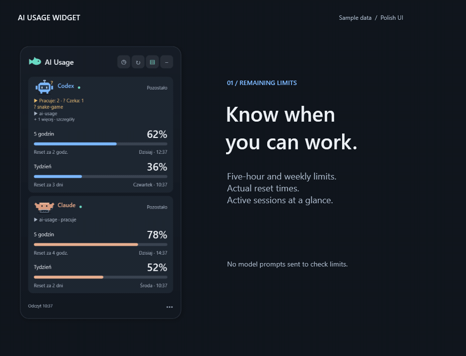
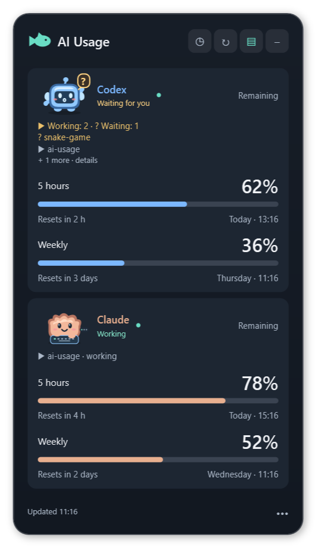
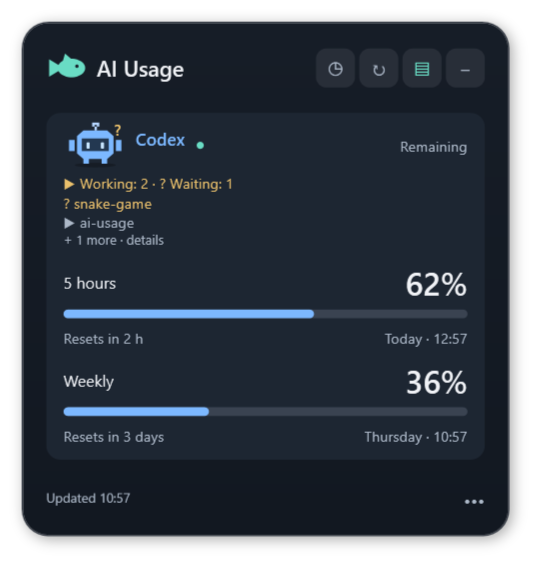
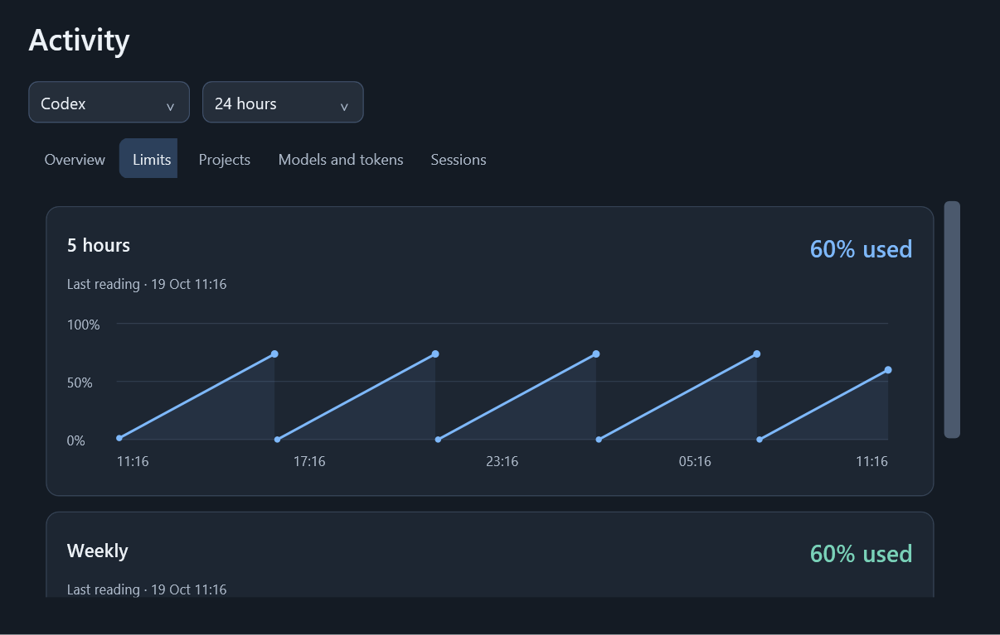
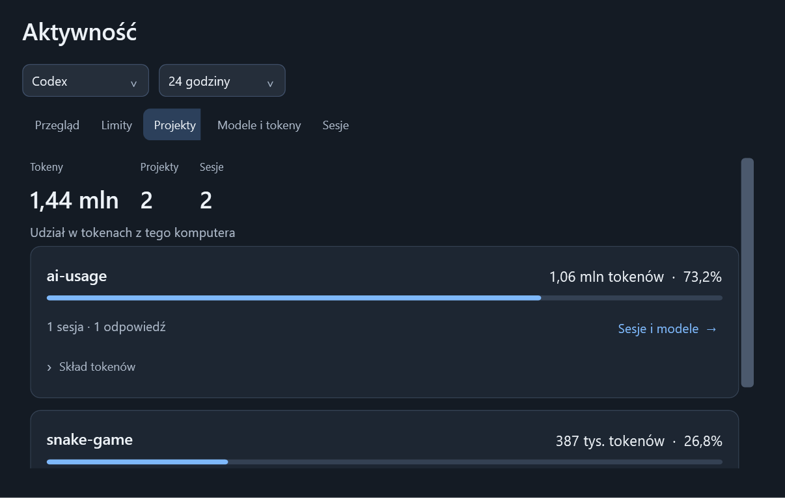

# AI Usage Widget

**See your remaining AI limits before you start the next task.**

A small Windows tray widget for **Codex, Claude Code, Devin, JetBrains Air and
Antigravity**. Keep only the accounts you use, see when their limits reset, and
spot sessions waiting for your attention.

**Windows 10/11 x64** · **.NET 9** · **[MIT](LICENSE)** · **Polish UI**

[Install with Codex](#install-with-codex) · [Quick start](#quick-start) · [Providers](#supported-providers) · [Help](docs/TROUBLESHOOTING.md) · [Polski](docs/README.pl.md)

## See it in action



*11 seconds. Real WPF views with sample data; no private accounts or conversations.
The interface is currently Polish. [Prefer still images?](#screenshots)*

## What you get

- **Remaining limits and reset times.** See the actual quota windows your account
  returns, with a countdown to the next reset.
- **Your choice of providers.** Detect installed clients, then show or hide any
  provider from the widget or tray menu. Changes apply without restarting.
- **Sessions that need you.** Codex and Claude show active projects, work in progress
  and requests waiting for input, with animated mascots.
- **History behind the numbers.** Explore quota history, projects, sessions and model
  token totals. Local token estimates remain separate from subscription percentages.
- **A widget that stays out of the way.** Switch between compact and full views,
  check the tray percentage, and get a notification when a quota is running low.

The widget's quota checks do not send model prompts or start AI tasks.

## Install with Codex

**Let Codex handle the setup on your Windows PC.** Open the prompt below, enter
your tools (for example `Codex, Claude Code`), and paste it into Codex. The repository
link is already filled in. Leave the tools field empty to detect installed clients.

Codex is instructed to find paths and prerequisites itself, ask only when something
necessary is missing, and continue after you complete any required account login.

<details>
<summary><strong>Copy the setup prompt</strong></summary>

```text
Set up AI Usage Widget on this computer and carry the work through to a working,
verified installation. Respond in the language I use.

Repository: https://github.com/morfidon/ai-usage-widget
AI tools I use: [ENTER YOUR TOOLS, e.g. Codex, Claude Code; OR LEAVE EMPTY TO DETECT]

Read the repository's AGENTS.md, README and relevant setup documentation first.
If this repository is already open locally, use that checkout. Otherwise clone or
download the repository above into a suitable writable directory yourself.

Work autonomously. Inspect the OS, installed applications, native executables,
existing widget installation, settings and account readiness yourself. Infer paths
and routine setup choices from that evidence instead of asking me to find them.
Treat unfilled bracketed fields as missing information, not literal values. Ask
only when necessary information cannot be found or reasonably inferred, a choice
materially changes the result, or an action genuinely needs my participation.
Group related missing details into one short question and continue independent work.

Enable only the supported providers matching my tools above. If the tools field is
empty, detect installed clients and use those; do not assume I have every provider.
Respect existing saved choices unless my list changes them. Explain unsupported
tools without silently substituting another provider. An empty selection is valid.

I authorize the local installation and verification of the widget, its verified
per-user .NET prerequisites, and the required Central CLI if I selected JetBrains Air.
If a selected provider's native client is missing, check its official installation
instructions and install it for my user where possible. Do not buy subscriptions.
Keep autostart unchanged, and leave it off on a fresh installation. For selected
Claude Code, you may enable the backed-up status line bridge if needed for quota
reads; explain that change and preserve the previous status line. Use repository
defaults for other optional preferences instead of asking about each one.

Use setup.ps1 with the appropriate provider selection and prerequisite options.
Preserve existing settings, history and unrelated configuration. Diagnose and fix
setup problems within this scope; do not stop after a plan, build, or first error.
If the environment cannot run the Windows widget, explain exactly what environment
is needed rather than claiming installation succeeded.

If login, account selection, or another required human step remains, tell me the
exact action in the provider's own app or browser. Never ask me to paste credentials.
Wait for my answer when it is needed, then resume verification without repeating
completed installation steps. Do not send model prompts or paid test requests.

Finish by checking current limits for selected providers, launching the widget,
and verifying its visible window and tray behavior. Use the setup and doctor
reports as evidence; an unselected provider is not an error. Report briefly what
works, where to open the widget, and any specific unresolved blocker. Do not claim
a provider works or Windows autostart was verified without actually checking it.
```

</details>

No clients installed yet? You can still prepare the widget and choose providers
later. You do not need subscriptions to all five services.

## Quick start

Prefer to run the setup yourself? With Git installed, open **64-bit Windows
PowerShell 5.1 or PowerShell 7** and run:

```powershell
git clone https://github.com/morfidon/ai-usage-widget.git
cd ai-usage-widget
powershell -NoProfile -ExecutionPolicy Bypass -File .\setup.ps1 -InstallPrerequisites
```

You can also download the repository ZIP, extract it, and run only the setup
command from that folder.

Setup detects clients, obtains the verified per-user .NET prerequisites if needed,
builds, tests, installs and opens the widget. No administrator access is needed.
For an explicit selection, append `-Providers "Codex,Claude"`; `-Providers None`
starts with no cards. Autostart is off on a fresh install unless you enable it.

**What happens next:** a ready account shows its limits. If login is needed, setup
reports the exact action. Open **AI Usage Widget** from Start; use **••• → Dostawcy**
to change accounts. Your choice is remembered.

Native Windows x64 is required; WSL, macOS, Linux, ARM64 and x86 are outside this
setup path. Python, Node and FFmpeg are not required to build or run the widget.
See [full setup, options, update and uninstall instructions](docs/SETUP.md).

## Supported providers

| Provider | What the widget shows | What you need |
|---|---|---|
| **Codex** | Returned quota windows and model pools; local sessions and token statistics | Native Codex client, signed in |
| **Claude Code** | Five-hour, weekly and other returned quotas; local sessions and token statistics | Native Claude Code CLI, signed in |
| **Devin** | Active daily/weekly quotas returned for the plan | Signed-in Devin Desktop |
| **JetBrains Air** | Monthly JetBrains AI credits and additional credit balances | JetBrains account connected through Central CLI |
| **Antigravity** | Returned Gemini and Claude/GPT quota groups and reset times | Antigravity running and signed in |

**Every provider is optional.** Hidden providers are not polled or indexed; saved
quota history stays available when you enable them again. A temporary connection
problem keeps a selected card visible with its status.

Some integrations use internal client interfaces that can change after updates.
[Connection instructions and compatibility](docs/PROVIDERS.md) explain the details.

## Screenshots

<details>
<summary><strong>Show full-size screenshots — static alternative to the animation</strong></summary>

### Your limits, together or one at a time




### Quota history



### Project and token breakdown



All screenshots use sample data. [Regenerate the media](docs/MEDIA.md) from the real
application views when the UI changes.

</details>

## A few useful answers

**Will checking limits spend my AI credits?** The widget reads quota/status data;
it does not submit model prompts. Using Codex itself to set up the app is a separate
AI session and follows your Codex account's normal usage rules.

**Where does my information go?** Quota history and settings stay in your local app
data. Selected providers are queried through their existing clients or account
interfaces. [Privacy and data access](docs/PRIVACY.md) lists the files, endpoints,
backups and screenshots involved.

**What if setup cannot connect?** Follow the action in its report, or use the
[symptom-by-symptom troubleshooting guide](docs/TROUBLESHOOTING.md). Missing
unselected providers are not installation failures.

## Documentation and contributing

| Looking for… | Read this |
|---|---|
| Installation, updates, paths and rollback | [Setup guide](docs/SETUP.md) |
| Account login and custom client locations | [Provider guide](docs/PROVIDERS.md) |
| Errors and recovery | [Troubleshooting](docs/TROUBLESHOOTING.md) |
| Local files, credentials and network access | [Privacy](docs/PRIVACY.md) |
| Instrukcja obsługi po polsku | [Polska dokumentacja](docs/README.pl.md) |
| Builds, tests and coding-agent instructions | [AGENTS.md](AGENTS.md) and [verification commands](docs/SETUP.md#building-and-verification) |
| Measured performance and its limits | [Performance report](PERFORMANCE_2026-10-18.md) |

Bug reports and focused fixes are welcome. Include your Windows/client versions,
the exact command or action, and a sanitized error. Please keep account credentials,
conversation databases and full settings backups out of issues. Before changing
code, read [AGENTS.md](AGENTS.md) and run the checks relevant to the change.

Licensed under [MIT](LICENSE). Provider names and marks belong to their respective owners.
